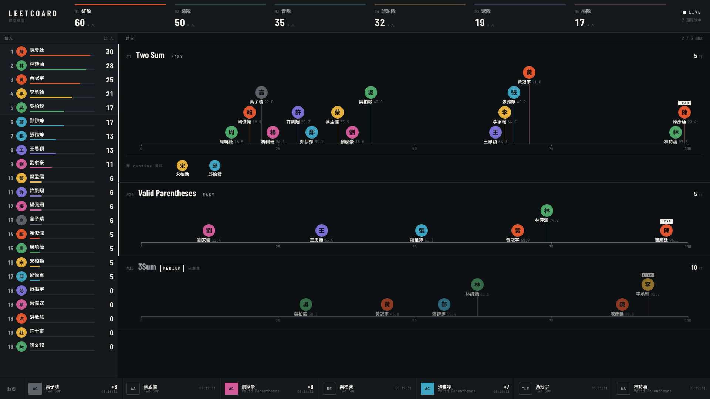

<div align="center">


**LeetCode x Scoreboard** — 課堂練習即時計分板

[](https://fastapi.tiangolo.com)
[](https://www.python.org)  

[](https://react.dev)
[](https://vitejs.dev)
[](https://www.typescriptlang.org)
[](https://workers.cloudflare.com)

</div>

## 總覽

LeetCoard 是投影用的即時計分板，給社課現場帶練習題用。老師在控制台逐題開放，
學員在 LeetCode 上寫，後端輪詢他們的提交，畫面即時更新。

這不是比賽系統。沒有開始時間、沒有結束時間、沒有提交次數上限——**每一題自己
帶一個開放視窗，老師按下開關就是計時的開始與結束**。排行榜存在的理由是好勝
心：畫面最上方是六組的組別排行，左側是個人排行，中間是每一題的 runtime 百分
位賽道。

### 介面預覽

**公開計分板（投影畫面）**



**控制台**


### 特色

- **逐題開放** — 每題自己的 `opened_at` / `closed_at` 視窗，開關即時生效。關題
  時記下時間點而不是直接關門，所以關題前一秒送出、下一輪才被抓到的 AC 仍然計分
- **百分位賽道** — 每題把解題者畫在 0–100 的 runtime 百分位軸上。解出來就上場，
  優化就往右滑。這也是「無限重送」這條規則的視覺意義所在
- **兩個排行榜** — 六組固定組別的組別排行放在畫面最上方中央，個人排行在左側，
  前五名固定不動、其餘自動輪播，70 人也都輪得到自己
- **顏色即身分** — 介面本身沒有彩度，畫面上每一抹顏色都代表某一組；難度改用字重
  編碼（純文字／描邊／實心），色盲也讀得出來。組別色在控制台可即時改 hex
- **注意力導向輪詢** — 剛送出提交的人每 5 秒查一次，安靜的人指數退到 60 秒，全體
  合計不超過 `POLL_MAX_RPS`。全部題目關閉時完全不呼叫 API
- **改題即重算** — 刪題、改分數、改 bonus 級距都會立刻重算全體分數，不會出現同一
  題兩種身價
- **原子化持久化** — `data/contest.json` 以 `tmp + os.replace` 寫入並保留 `.bak`，
  重啟後狀態完整恢復
- **多 cookie 輪替** — `LEETCODE_SESSIONS` 支援逗號分隔，自動 round-robin + cooldown

## 前置需求

| 項目 | 需求 |
|------|------|
| Python | 3.11+ |
| Node.js | 20+ |
| LEETCODE_SESSION cookie | 選填（取得 beat-% 需要） |

## 安裝

```bash
git clone https://github.com/xinshoutw/leetcoard.git
cd leetcoard

# 後端
python3 -m venv .venv
source .venv/bin/activate
pip install -e '.[dev]'
cp .env.example .env   # 至少填 ADMIN_TOKEN

# 前端
cd frontend
npm install
```

## 快速開始

```bash
# 後端（root 目錄）
uvicorn app.main:app --reload --port 8080

# 前端（frontend/）
npm run dev    # http://localhost:5173
```

打開 [`http://localhost:5173/`](http://localhost:5173/) 看計分板，
[`/dashboard`](http://localhost:5173/dashboard) 進控制台。
健康檢查：[`http://localhost:8080/api/health`](http://localhost:8080/api/health) 應回 `{"ok":true}`。

## 專案結構

```
leetcoard/
├── app/                          # FastAPI 後端
│   ├── main.py                   # ASGI entrypoint、lifespan
│   ├── core/
│   │   ├── auth.py               # 管理員 token 驗證（含 SSE query token）
│   │   ├── config.py             # 環境變數
│   │   ├── scoring.py            # beat-% 級距換算（純函式）
│   │   ├── sse.py                # SSE fanout（public / admin 分流）
│   │   └── storage.py            # 原子化 JSON 持久化（.tmp + .bak）
│   ├── domain/
│   │   ├── models.py             # Pydantic schema、Problem.accepts() 開放視窗
│   │   └── state.py              # ContestEngine：唯一計分權威
│   ├── routes/
│   │   ├── public.py             # 唯讀 snapshot / stream / health
│   │   └── admin.py              # 題目、開關、名單、組別、輪詢狀態
│   ├── integrations/
│   │   └── leetcode.py           # httpx client + cookie 輪替
│   └── workers/
│       └── polling.py            # 注意力導向輪詢排程
│
├── frontend/                     # React + Vite SPA
│   └── src/
│       ├── routes/
│       │   ├── Scoreboard.tsx    # 公開計分板（投影用）
│       │   └── Dashboard.tsx     # 控制台
│       ├── components/
│       │   ├── scoreboard/       # TeamBar / Standings / ProblemStack
│       │   │                     # PercentileTrack / Ticker
│       │   ├── dashboard/        # PracticePanel / ProblemsPanel
│       │   │                     # ParticipantsPanel / EventsPanel / Login
│       │   └── ui/               # Avatar / DifficultyMark / Switch / icons
│       ├── hooks/
│       │   ├── useContestStream.ts  # snapshot + SSE 對齊、自動重連
│       │   └── useAutoScroll.ts     # 個人榜輪播
│       └── lib/                  # api / color / score / types / leetcode
│
├── data/                         # contest.json（執行時產生，已 gitignore）
├── tests/                        # pytest
└── pyproject.toml
```

## 計分規則

每位學員對每題：

1. **開放視窗** — 只有 `opened_at ≤ submittedAt ≤ closed_at` 的 AC 才計分。題目
   從沒開過、或 AC 落在關閉期間，一律不計分（仍會記成事件）
2. **基礎分** — 視窗內第一次 AC，加上題目設定的 `points`
3. **Beat-% 加分** — 可選，每題可設多階區間（例：`≥90% → +4`、`≥60% → +2`）。
   第一次 AC 套用對應階級，之後進步到更高階只補加差額
4. **無提交次數上限** — 想重送幾次都可以，每次都可能刷新 runtime。即使沒跨到更高
   階，賽道上的標記仍然會往右移動
5. **去重** — 同一個 `submission_id` 只計一次
6. **不在清單裡的題** — 完全忽略，不記事件也不計分

個人排名：分數高優先；同分以「達到目前分數的時間」較早者勝出。
組別排名：組員分數直接加總；同分以該組最後得分時間較早者勝出。未分組的學員不
列入任何組。

刪題、改 `points`、改 bonus 級距都會觸發全體重算，重算的依據是每位學員存下來的
「該題最佳 beat-%」，不是事件紀錄（事件有 500 筆上限，長時間練習會被截斷）。

## 分組

固定六組，只能改組名與顏色，不能增減。指派方式三種都支援：

- 批量匯入 `username,姓名,組別`，第三欄可略（留空不會動到既有組別）
- 名單每列的下拉選單隨時改
- 組別分數是即時加總，換組不需要搬移任何資料，分數跟著人走

## 上課流程

1. 填好 `.env`（`ADMIN_TOKEN` 必換；`LEETCODE_SESSIONS` 沒填就沒有 beat-% 加分）
2. 控制台：
   - 設定六組的組名與顏色
   - 貼上名單（`username,姓名,組別`）
   - 加題目、設分數與加分區間，按「儲存」
3. 開場時所有題目都是關閉的，公開板上看不到任何題目，後端也不會呼叫 LeetCode API
4. 要放哪一題就按哪一題的開關，題卡會出現在公開板上，輪詢同時啟動
5. 講解前把題目關掉，卡片與成績會留在板上並置灰
6. 需要重來時按「重置分數」，題目、名單、組別設定都會保留

## 環境變數

| Var | 預設 | 說明 |
| --- | --- | --- |
| `ADMIN_TOKEN` | `change-me` | 控制台登入用，部署前必換 |
| `LEETCODE_SESSIONS` | `""` | LEETCODE_SESSION cookie，逗號分隔多個 |
| `LEETCODE_API_BASE` | `https://leetcode-api-pied.vercel.app` | upstream API |
| `DATA_DIR` | `./data` | JSON 持久化資料夾 |
| `POLL_MIN_INTERVAL_SEC` | `5` | 活躍學員的輪詢間隔下限 |
| `POLL_MAX_INTERVAL_SEC` | `60` | 安靜學員退避到的上限 |
| `POLL_MAX_RPS` | `6` | 全體合計請求上限（次/秒） |
| `POLL_RECENT_LIMIT` | `10` | 每次輪詢取的 submission 筆數 |
| `POLL_JITTER` | `0.2` | 抖動，避免同步突發 |
| `POLL_CONCURRENCY` | `8` | 同時在途請求數上限 |
| `POST_END_GRACE_SEC` | `90` | 最後一題關閉後仍輪詢的寬限期 |
| `LEETCODE_HTTP_TIMEOUT_SEC` | `10` | httpx 超時 |
| `CORS_ORIGINS` | `*` | 逗號分隔，正式環境填具體網域 |

## 開發

```bash
# 後端測試
pytest -q

# 後端 lint
ruff check app tests

# 前端型別檢查
cd frontend && npm run lint

# 前端建置
npm run build
```

## 部署

### 後端（自架）

任何能跑 Python 3.11+ 且有 stable filesystem 的機器。對外用 nginx 或 cloudflared
反代，注意：

- SSE 需要 `proxy_buffering off;` 並把 `proxy_read_timeout` 拉長
- `.env` 的 `CORS_ORIGINS` 寫入前端網域

> **從舊版（比賽模式）升級**：狀態檔格式不相容。舊檔的 `student_id` 欄位已改名為
> `nickname`，載入舊檔會驗證失敗、退回空白狀態。升級前請先刪掉
> `data/contest.json` 與 `data/contest.json.bak`，再重新匯入名單與題目。

範例 systemd unit：

```ini
[Service]
WorkingDirectory=/srv/leetcoard
EnvironmentFile=/srv/leetcoard/.env
ExecStart=/srv/leetcoard/.venv/bin/uvicorn app.main:app --host 0.0.0.0 --port 8080
Restart=always
```

### 前端（Cloudflare Workers）

```bash
cd frontend
npm install
npm run build
npx wrangler deploy
```

`wrangler.jsonc` 處理 SPA fallback；前端透過 `VITE_API_BASE` 直連 API origin
（不走 Worker proxy，避免無限轉發）。

## 已知假設

- 一台投影機播公開板，控制台由一位老師操作；一個 token，沒有多管理員角色
- 70+ 名學員的帳號被輪詢；同時開著公開板的瀏覽器數量假設不多
- 組別固定六組，只能改名與改色
- 沒有「開題前是否已 AC 過該題」的檢查（需要學員本人 cookie，不可行）。實務上
  影響有限：輪詢只看最近幾筆提交，開題前的舊 AC 不會被抓到，學員得重新送出才會
  計分
- beat-% 需要 `LEETCODE_SESSIONS`；沒設定時百分位賽道會退回成單純的解題者列表

## 貢獻

歡迎 PR 與 Issue。送出前請確認：

1. 後端 `pytest -q` 與 `ruff check app tests` 通過
2. 前端 `npm run lint` 與 `npm run build` 通過
3. 分支以 `feature/...` 或 `fix/...` 命名
4. PR 目標分支為 `main`

## 授權

本專案採用 [MIT License](LICENSE) 授權。
